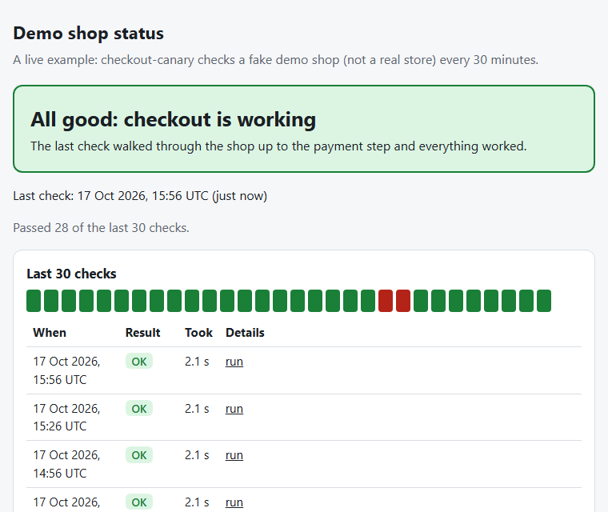
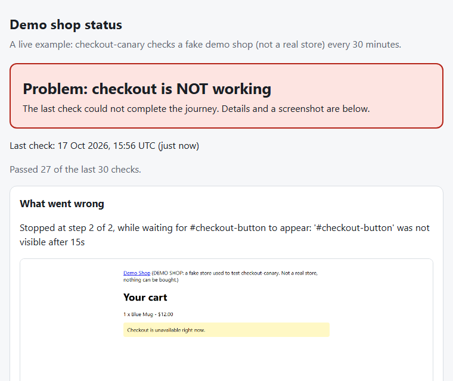
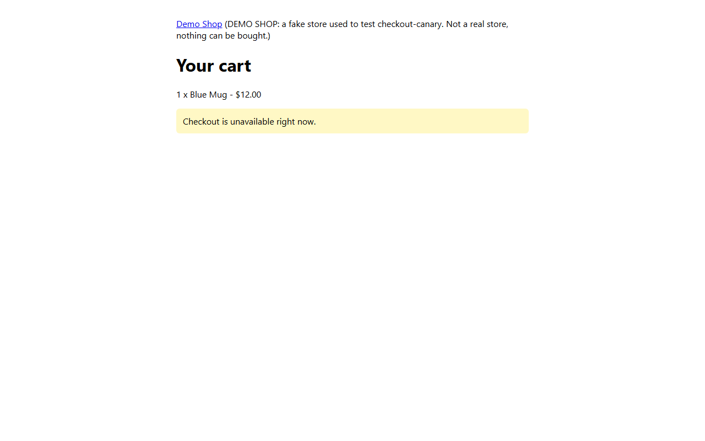

# checkout-canary

**Does your online store's checkout still work right now?** checkout-canary opens your store in a
real browser, walks the path a customer takes (home, product, cart, checkout), stops before payment,
and tells you pass or fail in plain language, with a screenshot when something breaks.

It is free, open source (MIT), runs on your own machine or on GitHub Actions, and needs no server.

> **Status: pre-alpha, version 0.1.0.** The core runner works and is tested against local fake shops.
> It has **not** been tested against any real store. The Magento 2 and WooCommerce presets are
> **experimental, not verified against a live store**. See [What works today](#what-works-today).

| Checkout works | Checkout broken |
| --- | --- |
|  |  |

*Status pages generated by `checkout-canary status update` from sample history (the failure
screenshot comes from a real run against the fake demo shop). Live demo: see
[docs/scheduling.md](docs/scheduling.md); the link will be
`https://jigar48.github.io/checkout-canary/` once GitHub Pages is enabled and the workflow has run.*

## Why

An uptime ping says the server answered. It does not say a customer can still add a product to the
cart and reach checkout. Hosted monitoring services exist, and so do blog posts on wiring Playwright
into cron yourself. checkout-canary aims to be a free, self-hosted, packaged option with owner-readable
output. I have not proven that nothing similar exists.

## Safety: read this first

- **Only run checkout-canary against sites you own or have written permission to test.**
- It never places an order and never submits payment details. Journeys must stop before the payment
  step. The presets stop at the shipping or payment section and are tested to never touch "place order".
- It identifies itself: `User-Agent: checkout-canary/<version> (+https://github.com/jigar48/checkout-canary)`.
- Steps run one after another, one browser, low request rate. It does not bypass CAPTCHAs or bot
  protection.
- Do not put real passwords, card numbers or tokens in journey files. Tokens for alerts go in
  environment variables or GitHub Actions secrets, never in the repository.
- Each run may leave an abandoned cart in your store (that is what a customer who walks away does).

## What works today

| Feature | State |
| --- | --- |
| `checkout-canary run <journey.yml>` with six step types, JSON result, failure screenshot and trace, exit codes 0/1/2 | Works. Tested against a local fake shop in CI. |
| Telegram alert on failure | Works against a fake local Telegram server in tests. Never sent a real message yet. |
| Static status page with last 30 runs + scheduled GitHub Actions workflow + demo shop on GitHub Pages | Page generation is tested. The **workflow has not run on GitHub yet**; it only runs after merge and a one-time setup ([docs/scheduling.md](docs/scheduling.md)). |
| Magento 2 preset | **Experimental.** Tested only against a local fixture imitating Luma markup. |
| WooCommerce preset (classic cart/checkout) | **Experimental.** Tested only against a local fixture. Does not match the block-based Cart/Checkout. |
| Slack / email alerts, retries, several journeys per file, hosted service | Not built. |

## Quickstart (about 5 minutes, no real shop needed)

Requires Python 3.12 or newer. This runs a journey against a small fake shop included in this repo.

```bash
git clone https://github.com/jigar48/checkout-canary.git
cd checkout-canary
python -m venv .venv
source .venv/bin/activate          # Windows: .venv\Scripts\activate
pip install -e .
python -m playwright install chromium
```

Terminal 1: serve the **working** fake shop.

```bash
python -m http.server 8000 --bind 127.0.0.1 --directory tests/fixtures/shop/ok
```

Terminal 2: run the example journey.

```bash
checkout-canary run examples/demo-shop.yml
```

Every step shows `[PASS]`, the last line says `PASS: 'Demo shop checkout' completed all 12 steps.`
and the exit code is 0.

Now stop the server (Ctrl+C) and serve the **broken** shop, where the cart has no checkout button:

```bash
python -m http.server 8000 --bind 127.0.0.1 --directory tests/fixtures/shop/broken
checkout-canary run examples/demo-shop.yml
```

```text
  [PASS] 7. screenshot cart (42 ms)
  [FAIL] 8. expect_visible #checkout-button (3009 ms)
         '#checkout-button' was not visible after 3s
  [SKIP] 9. click #checkout-button
  ...
FAIL: 'Demo shop checkout' stopped at step 8 of 12 (expect_visible #checkout-button): '#checkout-button' was not visible after 3s
```

The exit code is 1 and the evidence is in `results/`:

| File | What it is |
| --- | --- |
| `results/result.json` | Per-step status, timings, error message, plain-language summary |
| `results/failure.png` | The page at the moment of failure (failures only) |
| `results/trace.zip` | Playwright trace (failures only): `python -m playwright show-trace results/trace.zip` |
| `results/screenshots/` | Screenshots from `screenshot` steps |



`results/` is git-ignored. Files from an earlier run are overwritten, not deleted; trust `result.json`
for the latest run.

## Use it on your own store

1. Write a journey: read the [journey guide](docs/journey-guide.md), or copy a preset from
   [`presets/`](presets).
2. Run `checkout-canary run my-store.yml` (your own store only).
3. Optional: [alerts](#failure-alerts-telegram) and [scheduled runs with a status page](docs/scheduling.md).

```text
checkout-canary run JOURNEY.yml [--output-dir DIR] [--base-url URL]
checkout-canary status update --data-dir DIR --site-dir DIR [--result FILE] [--title T] [--note N]
```

| Exit code of `run` | Meaning |
| --- | --- |
| 0 | Journey passed |
| 1 | A step failed |
| 2 | Could not run: invalid or missing journey file, or the browser could not start |

### Journey format in two examples

A step is a mapping with exactly one action: `goto`, `click`, `fill`, `expect_text`,
`expect_visible`, `screenshot`. Full reference and tips: [docs/journey-guide.md](docs/journey-guide.md).

```yaml
name: Product page loads
base_url: https://shop.example.com
steps:
  - goto: /products/blue-mug
  - expect_visible: "#add-to-cart"
  - screenshot: product
```

```yaml
name: Reach checkout
base_url: https://shop.example.com
timeout_ms: 8000
steps:
  - goto: /products/blue-mug
  - click: "#add-to-cart"
  - expect_text:
      selector: h1
      text: Your cart
  - click: "#checkout-button"
  - fill:
      selector: "#email"
      value: test@example.com
  - expect_visible: "#payment-step"
```

(`shop.example.com` is a placeholder.) Mistakes are reported with the step and field, for example
`step 2 > fill > value: Field required`.

## Failure alerts (Telegram)

When a journey fails, checkout-canary can send a short plain-English message through the Telegram Bot
API ([`sendMessage`](https://core.telegram.org/bots/api#sendmessage)). It is off unless both
environment variables are set:

| Variable | Value |
| --- | --- |
| `CHECKOUT_CANARY_TELEGRAM_TOKEN` | Bot token from [@BotFather](https://core.telegram.org/bots#how-do-i-create-a-bot) |
| `CHECKOUT_CANARY_TELEGRAM_CHAT_ID` | Chat, group or channel ID the bot may write to |

```bash
export CHECKOUT_CANARY_TELEGRAM_TOKEN="..."      # never commit this
export CHECKOUT_CANARY_TELEGRAM_CHAT_ID="..."
checkout-canary run my-journey.yml
```

The message names the journey, the step that failed in plain words, the reason, the time (UTC) and,
inside GitHub Actions, a link to the run. It never contains fill values or secrets. Alerts are best
effort: if sending fails, the problem is printed with the token redacted and the exit code stays the
journey's own. Alerts go out on failure only. The alert code is a small `Notifier` interface
([`alerts.py`](src/checkout_canary/alerts.py)) so more channels can be added later.

## Presets (experimental)

| Preset | Covers | Status |
| --- | --- | --- |
| [`presets/magento2.yml`](presets/magento2.yml) | Home, product, add to cart, cart, checkout shipping step | **Experimental, not verified against a live store.** Selectors taken from the public `magento/magento2` templates. |
| [`presets/woocommerce.yml`](presets/woocommerce.yml) | Shop, product, add to cart, cart, checkout up to the payment section | **Experimental, not verified against a live store.** Classic shortcode pages only; selectors from the public `woocommerce/woocommerce` templates. |

Both are tested only against local fixtures (`tests/fixtures/magento2`, `tests/fixtures/woocommerce`)
that imitate that markup. Real stores differ (themes, extensions, caching): expect to adjust
selectors. If you verify a preset on a store you own, please tell me via an issue.

## Scheduled runs and status page

`.github/workflows/monitor.yml` runs the demo journey every 30 minutes, keeps the last 90 runs on a
`status-data` branch, and publishes a green/red status page to GitHub Pages. Scheduled workflows are
best effort (they can be late or dropped) and GitHub disables them in public repositories after 60
days without repository activity. Setup steps and sources: [docs/scheduling.md](docs/scheduling.md).

## Development

```bash
pip install -e ".[dev]"
python -m playwright install chromium
ruff check . && ruff format --check .
pytest
```

Tests start local servers on free ports and need no internet. CI runs the same steps on every push.
See [CONTRIBUTING.md](CONTRIBUTING.md) and [CHANGELOG.md](CHANGELOG.md).

## Known limits

- Chromium only, headless, one viewport (1280x800), one journey per file, no retries.
- Tested on Python 3.12 (Linux in CI, Windows locally).
- No real store, no real Telegram bot and no real GitHub Pages deployment has been exercised yet.
- Failure messages are plain language for common cases (element not found, text not shown, HTTP
  error); other Playwright errors are shown shortened.

## License

MIT, see [LICENSE](LICENSE).
